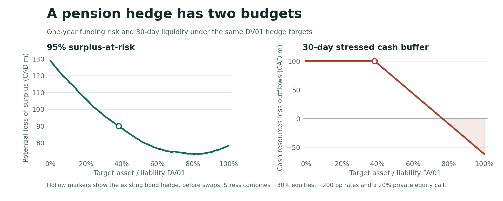

# Canadian pension surplus-at-risk and LDI lab

[Open the interactive case study](https://y68wu.github.io/pension-ldi-lab/) · [Try the liquidity simulator](https://y68wu.github.io/pension-ldi-lab/#liquidity) · [Read the project handbook](https://y68wu.github.io/pension-ldi-lab/handbook.html)

**A full DV01 hedge reduced one-year surplus-at-risk from CAD 90.0M to CAD 78.4M, but left a CAD 61.7M cash deficit in the combined stress.** The lowest modeled SaR was CAD 73.3M at an 83% hedge. At a 76% hedge, SaR was CAD 73.9M and the same stress left a CAD 1.4M cash buffer.



| Total DV01 hedge | 95% SaR | Probability funded below 100% | 30-day cash buffer |
| --- | ---: | ---: | ---: |
| 38.4% · existing assets, no overlay | CAD 90.0M | 12.05% | +CAD 100.4M |
| 76% · lowest SaR on the grid with cash coverage ≥ 1 | CAD 73.9M | 9.46% | +CAD 1.4M |
| 83% · lowest modeled SaR on the grid | CAD 73.3M | 9.56% | −CAD 17.0M |
| 100% · parallel DV01 match | CAD 78.4M | 10.58% | −CAD 61.7M |

## Reproduce the study

Requires Python 3.10+ and public market-data access. The GitHub Pages site reads the published summary output and runs entirely in the browser.

```bash
python -m venv .venv
source .venv/bin/activate
python -m pip install -e '.[dev,notebook]'
python -m pension_ldi.market
pension-ldi
pytest -q
python -m http.server 8000 --directory docs
```

The [notebook](notebooks/01_pension_ldi.ipynb) reads the committed report and optionally reruns the empirical model. The [data dictionary](data/README.md) explains sources, proxy baskets and close alignment. Raw downloads stay local. The website publishes model outputs, simulated counts and assumption tables.

## Plan and valuation

The synthetic closed defined-benefit plan opens with CAD 1.05B in assets, CAD 1.00B in liabilities and a 105% funding ratio. It allocates 30% to public equity, 35% to long bonds, 15% to real assets, 10% to private equity and 10% to corporate credit.

The 60 annual nominal benefit payments follow a hump-shaped runoff schedule scaled to the opening PV and 15-year duration. The model discounts them using nine Bank of Canada zero-rate knots plus a fixed 50 bp spread. It linearly interpolates zero rates between knots and holds the last zero rate flat beyond 30 years. Parallel liability DV01 is CAD 1.50M per bp. [Cash flows](reports/benefits.csv) and [key-rate exposures](reports/key_rates.csv) show where that sensitivity comes from. See the [Bank of Canada zero curves](https://www.bankofcanada.ca/rates/interest-rates/bond-yield-curves/).

| Sleeve | Public price proxy | Direct rate component |
| --- | --- | --- |
| Public equity | XIU + VFV | Joint return relationship with rates |
| Long bonds | XLB | 20Y synthetic par bond cash flows |
| Real assets | ZRE + IGF | Joint return relationship with rates |
| Private equity | PSP translated to CAD | Joint return relationship with rates |
| Corporate credit | XCB | 8Y synthetic par bond cash flows at a fixed 90 bp spread |

PSP trades publicly. To illustrate stale private marks, the model applies an exponential appraisal filter with 55% weight on the prior reported return, then inverts the filter. Annualized volatility rises from 10.0% for the synthetic smoothed series to 18.5% for the recovered listed proxy. The inverse recovers the input by construction. This is a sensitivity to an assumed marking process. See the [listed ETF methodology](https://www.invesco.com/us/en/financial-products/etfs/invesco-global-listed-private-equity-etf.html) and [research on return smoothing](https://www.nber.org/papers/w9571).

## One-year surplus simulation

- The sample uses 166 joint monthly changes ending September 29, 2026. Starting values use the October 21, 2026 curve. The engine draws 20,000 one-year Gaussian scenarios from monthly joint log-return and absolute zero-rate change estimates, scaling the mean and covariance by 12.
- To avoid counting the same yield move twice, the long-bond and credit ETF returns are stripped of the modeled rate price effect before estimating the joint distribution. At the horizon, the model compounds those residual returns and applies full rate repricing. The same simulated curve discounts the remaining liabilities. First-year benefits reduce assets and leave the liability schedule.
- Surplus equals assets less liabilities. SaR at 95% equals opening surplus minus the fifth percentile of horizon surplus. Funding ratio equals horizon assets divided by horizon liability PV. Expected surplus is the Monte Carlo mean at year-end.
- Euler allocations add to the **standard deviation** of surplus. Each contribution is covariance with total surplus divided by its standard deviation. The net rate mismatch combines direct bond and credit curve effects, the liability curve effect and the swap. A negative contribution indicates diversification in the joint sample. See [Euler results](reports/euler.csv).

## Hedge and liquidity

A 15-year single-curve swap changes total asset-side parallel DV01 without changing the opening asset allocation. The 0–100% target is **(asset DV01 + swap DV01) / liability DV01**. The bonds already provide 38.4%, so a 0% target requires paying fixed to cancel that exposure. Targets above 38.4% receive fixed. Every target uses the same simulated paths. Parallel matching leaves maturity-specific exposures. [Hedge frontier](reports/frontier.csv).

The minimum-SaR target on the one-point grid moves from 83% with the full calibration sample to 67% with the trailing 10 years and 39% with the trailing five years. The opening plan and cash-stress rules stay fixed. [Calibration-window comparison](reports/calibration_check.csv).

The 30-day liquidity test combines a 30% equity decline, a +200 bp parallel shift and a capital call equal to 20% of the opening private equity sleeve. It adds one month of benefits and cash variation margin equal to the negative swap mark. The fully hedged case requires CAD 162.1M of margin. Eligible proceeds come from selling capped portions of stressed public equity, long bonds and credit after haircuts. Real assets and private equity provide no eligible proceeds in this test. The 20% / 25% / 15% sale caps and 5% / 3% / 10% haircuts are illustrative. The model excludes contributions, repo capacity and positive margin receipts. [Cash waterfall](reports/liquidity.csv), [Bank of Canada pension liquidity research](https://www.bankofcanada.ca/2021/05/staff-analytical-note-2021-11/).

## Limitations

- The plan and cash flows are fictional. Benefit indexation, mortality, contributions, sponsor support and plan rules are outside scope.
- Monthly calibration uses listed proxies, a fixed covariance and IID Gaussian increments. Sample drift, listed private equity basis risk, tail dependence and regime changes can materially shift the reported results. Differences between adjacent hedge targets are subject to Monte Carlo and calibration uncertainty.
- Long-bond and credit cash flows proxy direct rate exposure. Actual ETF holdings, curve risk and spread sensitivity vary over time. Discount and credit spreads are held fixed. The swap uses a simplified Government of Canada single curve with annual payments.
- The stress is an instantaneous repricing mapped into one 30-day cash budget. It omits intraday margin timing, funding markets, repo or collateral substitutions and cash-flow sequencing. The 76% point is a grid result under the specified shock and cash rules.
